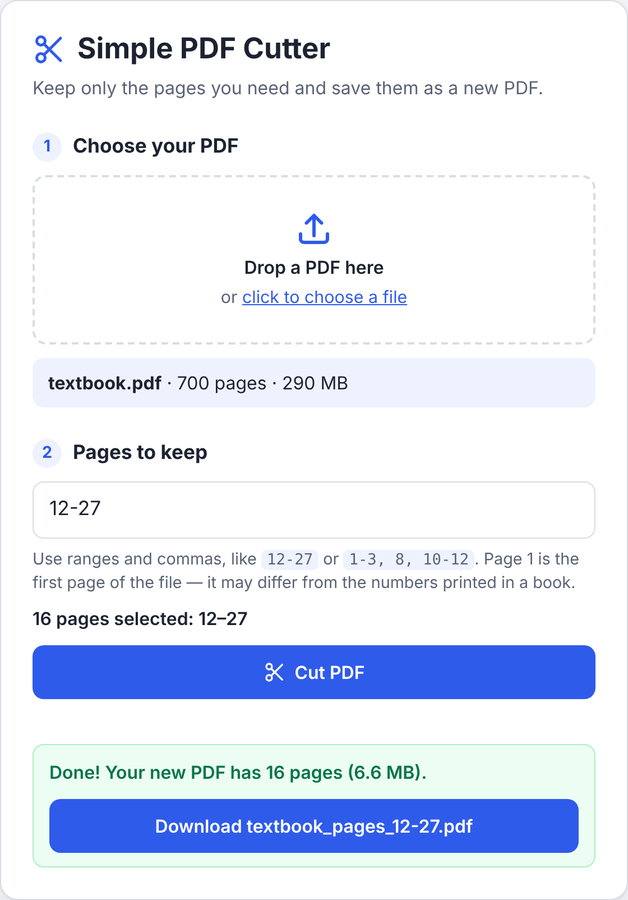
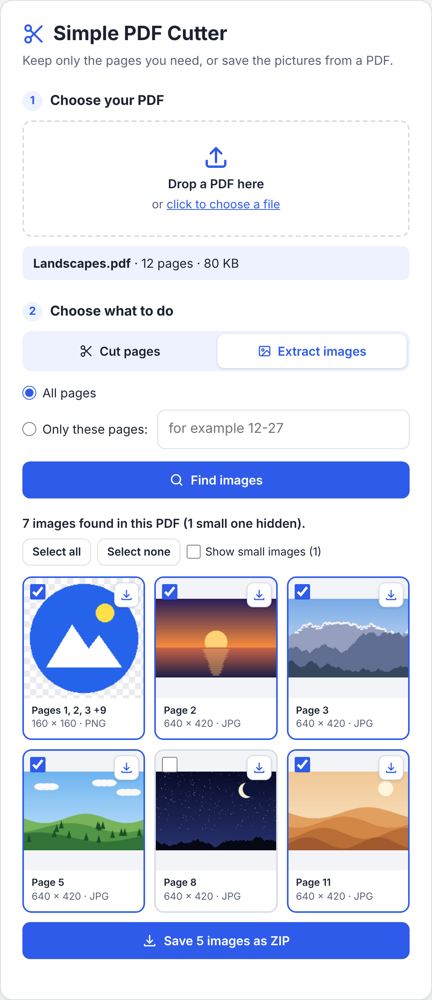

# ✂️ Simple PDF Cutter

Keep only the pages you need from a big PDF &mdash; for example **pages 12&ndash;27 of a 700-page
book** &mdash; and save them as a new, small PDF. Or save the **pictures** in a PDF as image files.

- **Easy:** choose a PDF, type the pages, click **Cut PDF**, download.
- **Saves pictures too:** finds the images on all pages, or only on the pages you choose, and saves
  them in full quality, one by one or all together in a ZIP file.
- **Private:** your PDF is processed inside your own web browser. It is never uploaded anywhere,
  and the tool works without an internet connection.
- **Opens protected PDFs:** e-books that are protected against copying or printing open as normal;
  for PDFs locked with a password, it asks for the password.
- **Clean results:** the new file contains only the pages you picked. Links between those pages
  keep working, and nothing from the rest of the book is hidden inside, so the file stays small.

<p align="center">
  
</p>

## How to use it

1. **Get the tool.** On this page, click the green **Code** button and choose **Download ZIP**.
   Unzip the downloaded file.
2. **Open it.** In the unzipped folder, double-click **`index.html`**. It opens in your web browser.
3. **Choose your PDF.** Drag it onto the page, or click **click to choose a file**.
4. **Type the pages to keep**, for example `12-27`, and click **Cut PDF**.
5. **Click Download.** The new file is named after the original, for example
   `book_pages_12-27.pdf`.

Keep `index.html` together with the `src` and `vendor` folders: the page needs them.

### Save the pictures from a PDF

1. Open `index.html` and choose your PDF, as above.
2. Click **Extract images**.
3. Keep **All pages**, or choose **Only these pages** and type the pages, for example `12-27`.
4. Click **Find images**. A preview of every image appears, each one ticked.
5. Untick the ones you don't want, click **Save … images as ZIP**, then **Download**. To save
   just one image, click the download arrow next to it.

The images are named after the page they are on, for example `page-012_image-1.jpg`, and the ZIP
file after the PDF, for example `book_images.zip`.

<p align="center">
  
</p>

### Use it from a web link instead (optional)

GitHub can host the tool for you as a web page, so it opens from a link on any computer or phone:

1. In this repository on GitHub, open **Settings &rarr; Pages**.
2. Under **Build and deployment**, choose **Deploy from a branch**, select the branch that has this
   code and the **`/ (root)`** folder, then click **Save**.
3. After a minute or two the tool is at `https://<your-user-name>.github.io/simple-pdf-cutter/`.

Files opened on that page are still processed only in the visitor's browser; they are not sent to
GitHub or anywhere else.

## Choosing pages

| You type        | You get                         |
| --------------- | ------------------------------- |
| `12-27`         | pages 12 to 27 (16 pages)       |
| `5`             | page 5 only                     |
| `1-3, 8, 10-12` | pages 1, 2, 3, 8, 10, 11 and 12 |
| `12 to 27`      | pages 12 to 27                  |

- **Page 1 is the first page of the file**, including the cover. Printed books often number their
  pages differently, so the page printed as "12" may be, say, page 30 of the file. Your PDF viewer
  shows the file's page number in its toolbar.
- Pages always stay in their original order, and a page listed twice is included once.

## Good to know

### Cutting pages

- The new PDF keeps the page contents exactly as they were, along with comments, highlights, web
  links and links between the pages you kept. It also keeps the document's title, author and
  language.
- Bookmarks are not copied. Filled-in form fields still show their contents but can't be edited in
  the new file.
- A PDF that needs a password to open still needs that password; the tool doesn't break passwords.
- Large files are fine: a 700-page, 290 MB test book opens in a few seconds and cuts in under a
  second on a normal computer. Very large files need a fair amount of memory, so phones may
  struggle with them.

### Saving pictures

- **Full quality:** photos (JPEG) are saved exactly as they are stored in the PDF. All other images
  are saved as PNG files, which lose nothing either; transparent parts stay transparent.
- An image that appears on several pages, such as a logo, is listed once, with the pages it is on.
- **Tiny images** &mdash; dots, lines and spacers less than 16 pixels wide or high &mdash; are
  hidden at first. Tick **Show small images** to see and save them too.
- Images are saved as they are stored: at their full resolution, which can be higher than they look
  on the page, and without the cropping or rotation the page may apply to them.
- **Scanned books work too:** black-and-white scans (JBIG2 and CCITT fax) and JPEG 2000 images are
  converted to PNG.
- Images in print colours (CMYK) or spot colours are converted to screen colours, except JPEG
  photos, which are always kept exactly as stored.
- Charts, diagrams and text that the PDF draws with lines and letters are not pictures, so there is
  nothing to save for them; take a screenshot instead.
- It is quick: a 300-page book with a photo on every page shows its images within a second, and
  saving all 300 into a 90 MB ZIP file takes about two seconds.

## Command line (optional)

If you have [Node.js](https://nodejs.org/) 22 or newer, you can also cut PDFs from a terminal:

```sh
node bin/pdf-cut.js book.pdf 12-27
# Saved 16 pages (12-27) to book_pages_12-27.pdf

node bin/pdf-cut.js book.pdf 1-3, 8 --output chapter-one.pdf
node bin/pdf-cut.js locked.pdf 12-27 --password "the password"
```

Existing files are never overwritten unless you add `--force`. Run `node bin/pdf-cut.js --help`
for all options.

To save the pictures in a PDF:

```sh
node bin/pdf-images.js book.pdf
# Saved 48 images in the PDF to book_images (left out 3 tiny images; add --small to save them too)

node bin/pdf-images.js book.pdf 12-27 --output pictures
```

The images go into a new folder next to the PDF, or into the folder given with `--output`. A folder
that already has files in it is only used if you add `--force`. Run `node bin/pdf-images.js --help`
for all options.

## For developers

There is no build step: the web page is plain HTML, CSS and JavaScript.

| Path                         | What it is                                                                     |
| ---------------------------- | ------------------------------------------------------------------------------ |
| `index.html`                 | The web page                                                                   |
| `src/pdf-cutter.js`          | Opening PDFs and cutting pages, shared by the web page and the command line    |
| `src/pdf-images.js`          | Finding the images in a PDF and turning them into image files                  |
| `src/formats.js`             | PNG and ZIP writers                                                            |
| `src/decoders.js`            | Loads the decoders for scanned-image formats when a PDF needs them             |
| `src/app.js`                 | Web page behaviour (file picking, password prompt, cutting, download)          |
| `src/image-panel.js`         | The web page's "Extract images" tab                                            |
| `src/styles.css`             | Web page styles, with automatic dark mode                                      |
| `bin/pdf-cut.js`             | Command-line tool for cutting pages                                            |
| `bin/pdf-images.js`          | Command-line tool for saving images                                            |
| `vendor/pdf-lib/`            | The PDF engine, [`@cantoo/pdf-lib`](vendor/pdf-lib/README.md)                  |
| `vendor/pdfjs/`              | JBIG2, CCITT fax and JPEG 2000 decoders from [PDF.js](vendor/pdfjs/README.md)  |
| `vendor/jpeg-js/`            | A [JPEG decoder](vendor/jpeg-js/README.md), for photos with transparency       |
| `scripts/vendor-decoders.js` | Regenerates the files in `vendor/pdfjs/` and `vendor/jpeg-js/`                 |
| `test/`                      | Unit, command-line and browser tests, with sample PDFs and images              |

### How it works

- **Reading** uses `@cantoo/pdf-lib`, a maintained fork of [pdf-lib](https://pdf-lib.js.org/) that
  can decrypt PDFs (RC4, AES-128 and AES-256). The original pdf-lib refuses encrypted files.
- **Copying pages** uses a small page copier of our own (`PageCopier` in `src/pdf-cutter.js`).
  pdf-lib's `copyPages()` follows every reference on a page, so a link to another page silently
  pulls that page, with its images and fonts, into the new file. Cutting pages 12&ndash;27 from a
  700-page scanned test book that way gave a 37 MB file containing 70 hidden pages; this copier
  gives 7 MB with none. It points links between kept pages at their new copies (including named
  destinations), drops links to removed pages, copies pages' inherited size, rotation and
  resources, and keeps hidden layers hidden.
- **Finding images** reads the drawing instructions of each page, including forms, tiling
  patterns, annotations and inline images, so it lists only images that are actually shown, not
  leftovers stored in the file. Each image object is listed once.
- **Saving images:** JPEG data is copied byte for byte, with the PDF's colour profile added when it
  has one. Everything else is decoded to pixels and written by a small PNG encoder
  (`src/formats.js`) that keeps the image's own bit depth, palette and gray or RGB colour profile,
  so a 1-bit scan stays a small 1-bit PNG. CMYK, Lab, spot colours (Separation and DeviceN with any
  kind of PDF function) and Decode arrays are converted to sRGB; soft masks, stencil masks and
  colour-key masks become transparency.
- **Scans** in JBIG2, CCITT fax and JPEG 2000 are decoded with the WebAssembly decoders from
  PDF.js, with plain-JavaScript fallbacks, loaded only when a PDF needs them.
- **ZIP files** are put together in the browser without compressing the images again (they are
  compressed already), so even large ones take only seconds.
- **Privacy:** everything runs in the browser and the page loads nothing from the internet. Its
  Content Security Policy also stops scripts from opening network connections or loading images
  from elsewhere, and the browser tests check that no request leaves the computer.

### Running the tests

```sh
npm install                          # installs Playwright for the browser tests
npm test                             # unit and command-line tests
npx playwright install chromium      # first time only
npm run test:e2e                     # browser tests, using index.html opened from disk
```

The image tests check results pixel by pixel, reading the PNG files with a PNG reader written for
the tests and with the independent decoder inside pdf-lib. If [qpdf](https://qpdf.readthedocs.io/)
and `unzip` are installed, the tests also use them to check that every PDF and ZIP file they
produce is well-formed.

The sample files in `test/fixtures/` were made with other software by
`test/fixtures/make_fixtures.py`: encrypted PDFs with qpdf and pypdf, and scanned images with
jbig2enc, libtiff, OpenJPEG and img2pdf. GitHub Actions runs all tests on every push.
